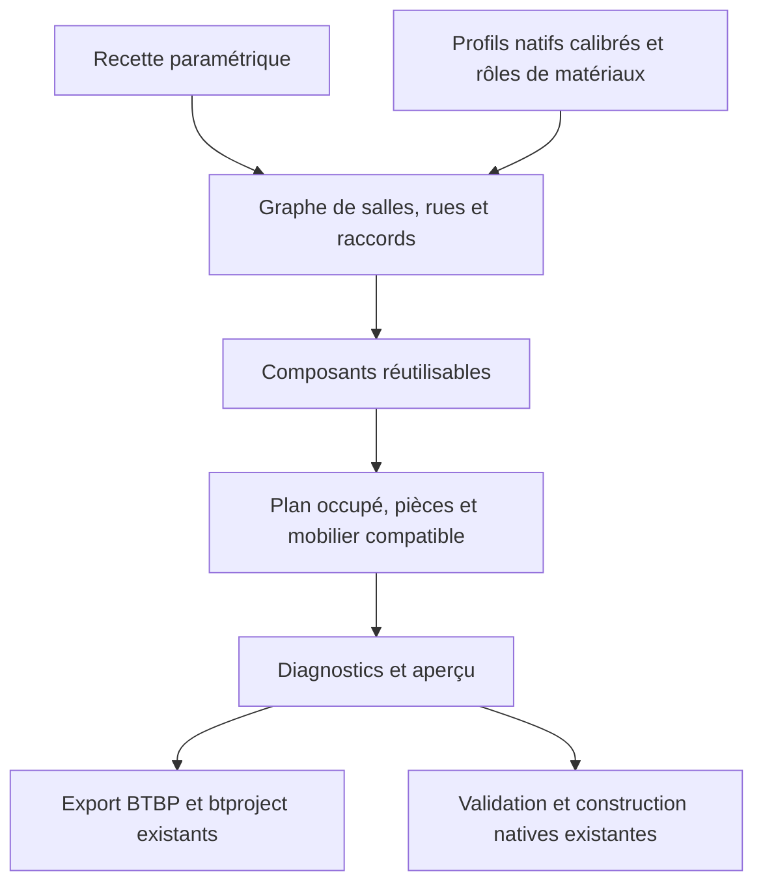

# Feuille de route — génération architecturale

Référence : audit du socle dev5 et préparation dev6,
[DEV6-AUDIT.md](DEV6-AUDIT.md). Priorités ordonnées par dépendance ; aucun délai ni
résultat moteur non observé n'est promis. Les tâches après P0 ne sont pas
implémentées par cette mission.

Ajout dev7 : une voie d'escaliers voxels, des dégagements persistants et un exemple
de trois niveaux sont préparés. La recette [DEV7-VOXEL-STAIRS.md](DEV7-VOXEL-STAIRS.md)
permet de tester une alternative sans pièces natives expérimentales. Elle ne
certifie pas qu'une contremarche de 0,5 m est franchissable sans saut. Les profils
inclinés/demi-blocs et le graphe architectural général restent des étapes futures.

## Architecture proposée

Une recette décrit l'intention ; le projet exporté reste un résultat concret,
inspectable et compatible. Le solveur ne doit pas exécuter de construction pour
chercher une solution. Le graphe porte des connecteurs typés et orientés avec
position, largeur, hauteur de passage, altitude du sol et rôle de matériau.
Un connecteur d'escalier porte une montée **calibrée**, distincte de sa hauteur
d'enveloppe. Les résultats sont déterministes pour une recette et une seed.

Les variantes de style sont des paramètres de profils, proportions et matériaux,
pas une nouvelle collection de fichiers fixes par bâtiment. Les bibliothèques de
petits modules BTBP existants restent utilisables comme composants.

## Faisabilité par objectif

| Objectif | Réutilisable maintenant | Évolutions nécessaires / limite |
|---|---|---|
| Château, tours et remparts | Tours carrées/rondes, murs, créneaux, sols, portes en ouverture, manifestes | Connecteurs tour/courtine, raccords d'angles, chemin de ronde continu, entrées et budgets d'autels ; château automatique absent |
| Escaliers monumentaux | Tracés droits/tournants/impériaux et vraies pièces | Profils natifs calibrés, largeur modulable par juxtaposition vérifiée, symétrie, sorties/paliers, collisions et test à pied ; aucune preuve que toute pièce se juxtapose |
| Ponts et galeries | Sols et murs paramétriques, passages composés validés J5 | Connecteurs à altitudes différentes, garde-corps, arches et pente, sondes du terrain/entités ; le passage testé ne valide pas tout pont |
| Bâtiments multiétages | Composants de coque, sols, trémies, fabrique dev6 | Graphe d'accès, cages d'escalier compactes en U, raccords des hauteurs, plafonds, collisions ; test natif dev6 préalable |
| Salle du trône | Grande coque, toiture, podium en voxels | Travées/colonnes/axes paramétriques, points d'attache, mobilier identifié et validé ; aucun trône interactif certifié |
| Village et quartiers par métiers | Plan sparse, modules répétés, routes/passerelles simples | Graphe de rues, parcelles, styles, seed, thèmes de métiers et rôle des bâtiments ; ne pas promettre PNJ/économie/progression |
| Terrasses et porte-à-faux | Sols, position/altitude, volumes et contrôle d'autels | Raccords, garde-corps et validation de passage/support selon le comportement réel ; aucune simulation structurelle dans le mod |
| Mobilier et décor natifs | Registre, transformations et filtre de compatibles | Profils sûrs, points d'attache, enveloppes d'entités, coût, interaction et persistance testés par famille |
| Portes/fenêtres logiques | Embrasures et placement manuel original | Writer d'événements, contexte propriétaire, relations, destruction et rechargement à établir ; automatisation actuellement bloquée |

## P0 — verrouiller le socle et les trois étages

**Travail livré/préparé :** audit, retour J5 enregistré, fabrique native de trois
étages, diagnostics, tests automatiques et pack dev6. **Reste à valider en jeu.**

1. Rejouer les trois modules (312 cellules) et les bâtiments reliés avec dev6.
2. Calibrer une vraie pièce d'escalier ; construire la démo aux rotations
   0/90/180/270°, marcher entre les trois niveaux et recharger le monde de test.
3. Vérifier le débit des matériaux en mode normal, les refus de stock et les
   limites d'autel/collision. Documenter les échecs et le comportement des lots.
4. Recharger le projet exporté et comparer dimensions, cellules, pièces, matériaux
   et positions ; conserver IDs de pièces, montée et version du jeu testés.

**Critère de sortie :** journal et fiche de recette remplis, circulation et
persistance constatées pour au moins un profil réel ; aucun échec des fonctions
dev5 rejouées. L'opt-in natif reste activé seulement pour les essais concernés.

## P1 — rendre les assemblages vérifiables

**Priorité haute, avant les générateurs de châteaux.**

- Ajouter un petit format de recette versionné avec validateurs stricts et
  champs de rôles structure/plancher/toit/encadrement ; garder les lecteurs
  BTBP/manifestes v1 et exporter vers eux.
- Stocker des profils natifs calibrés : modèle, axe, montée, entrées/sorties,
  empreinte, enveloppe et dégagement. Refuser un profil incompatible avec les
  données natives observées plutôt que réutiliser aveuglément une ancienne mesure.
- Introduire connecteurs orientés et graphe de circulation ; détecter sortie
  dans un mur, palier absent, altitude incompatible, trémie/porte bouchée et
  connecteur sans partenaire avant construction.
- Étendre le remplacement de matériaux aux pièces natives avec règles explicites
  et transaction du brouillon ; conserver les contrôles de registre/coût.

**Critère de sortie :** recettes déterministes, tests de raccords aux quatre
rotations et tests négatifs ; un aller-retour export/rechargement sans changement
de géométrie et un bâtiment calibré parcourable en jeu.

## P2 — premier château modulaire

- Composer enceinte, quatre raccords d'angle, tours, portail, cour, chemin de ronde
  et corps de bâtiment à partir des composants P1.
- Paramètres bornés : longueur/largeur, hauteur des remparts, types de tours,
  étages, style de toiture et rôles de matériaux ; pas de génération non bornée.
- Ajouter pont/galerie et salle d'apparat comme recettes de connecteurs, avec
  scénarios de circulation extérieure/intérieure.
- Proposer des variantes d'escaliers monumentaux uniquement pour les profils
  natifs effectivement calibrés et des garde-corps/embrasures en voxels.

**Critère de sortie :** chemin continu porte → cour → niveaux → remparts/tours,
aucun conflit de plan, diagnostics lisibles et budgets respectés ; essai en jeu
en créatif puis en mode normal. Décoration logique non requise pour cette étape.

## P3 — villages et décoration contrôlée

- Planifier rues puis parcelles puis bâtiments, avec seed et contraintes d'autels.
- Affecter des thèmes de quartiers (forge, ateliers, marché, logements) à partir
  de recettes et de rôles de mobilier ; aucun déblocage de PNJ ni de progression.
- Réserver les connecteurs d'entrée, trottoirs, galeries et hauteurs avant de
  distribuer les bâtiments ; exposer les conflits au lieu de découper en silence.
- Décorer par points d'attache et familles d'objets validées ; contrôler stock,
  collision d'entités et rechargement. Garder les objets logiques hors automatisation
  tant que leur cycle de vie n'est pas établi.

**Critère de sortie :** même seed = même plan, chaque entrée reliée à une rue,
gros plan généré et prévalidé sans geler l'interface, essais mesurés en jeu.

## P4 — robustesse à grande échelle et fonctions bloquées

- Déplacer la planification lourde en phases bornées/annulables, partager les
  mêmes données entre aperçu, diagnostic et exécution ; mesurer durée/mémoire
  sur les exemples volumineux avant d'augmenter une limite.
- Explorer en lecture seule les API natives de collision d'entités et les writers
  de portes/fenêtres. Tests par famille : création, usage, destruction, abandon,
  paiement et sauvegarde/rechargement avant toute ouverture du filtre.
- Étudier une récupération après interruption sans paiement/commit double. Un
  journal de progression seul ne suffit pas à autoriser une reprise automatique.
- Multijoueur et autels automatiques restent des chantiers distincts, conditionnés
  par protocole serveur, permissions, quotas et progression vérifiés.

Les contrôles de sécurité restent des conditions de faisabilité. Aucun chantier
ne doit « réussir » en les supprimant. La compilation et les tests de géométrie
ne valent jamais validation d'une interaction native.
